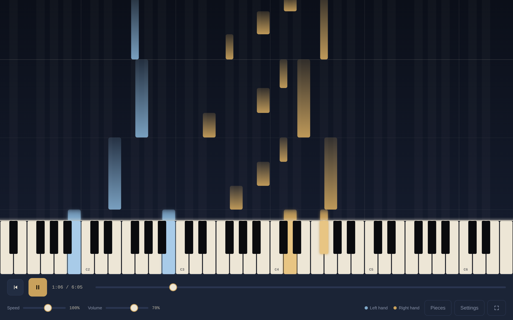
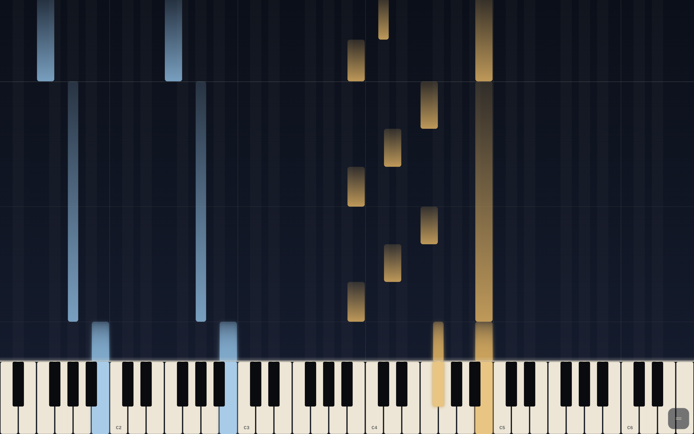
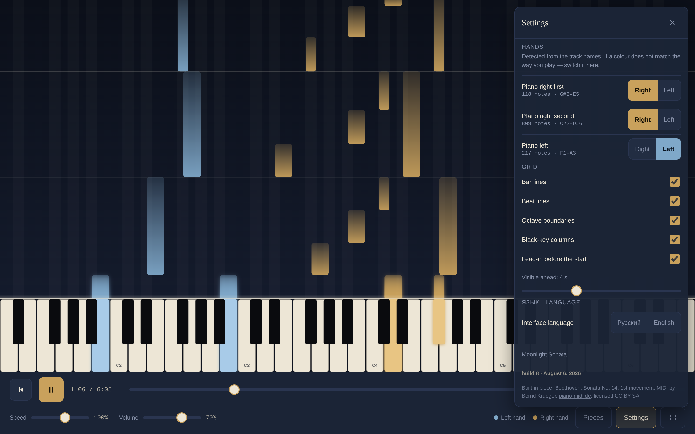

# Falling Notes

**[Русская версия →](README.ru.md)**

A piano practice trainer that plays MIDI files as falling notes. Notes stream down toward an on-screen keyboard — play each one as it reaches the light line. Left and right hands are colour-coded, sound is synthesised by the browser itself.

One HTML file, no dependencies, no build step, no server. Works offline.

**Try it live: [belf186.github.io/falling-notes](https://belf186.github.io/falling-notes/)**

## Features

- **Own MIDI parser** (format 0 and 1) — no libraries, understands tempo maps and time signatures
- **Hand separation**: detected from track names (six languages of common naming), or by average track pitch when names give nothing; single-track files are split by a pitch boundary you can drag. Any assignment can be overridden per track — your corrections are remembered per piece
- **Transport**: play/pause, seek, playback speed 25–150 % without pitch change, volume
- **Grid**: bar lines and beat lines (metre is read from the MIDI itself), octave boundaries, black-key columns — each one optional
- **Lead-in** before the first note, so the piece does not start point-blank
- **Piece library**: loaded files are stored on the device and switch with one tap
- **Keys-only mode**: hide every panel and give the whole screen to the notes
- **Interface in English and Russian** — switch anytime in Settings
- **Installs as an app** on iPad (Add to Home Screen), then works fully offline

## Gestures

| Gesture | Action |
|---|---|
| Short tap on the note field | Play / pause |
| Drag on the note field | Seek. Drag up — back in time, as if holding the note ribbon itself |
| Space / Home / ← → | Play-pause / to the beginning / ±5 s |

Panels hide with the button in the bottom-right corner of the transport and come back with the round button in the screen corner.

## Hands, grid and language

Everything lives in one Settings panel: per-track hand toggles with note counts and ranges, grid switches, look-ahead depth, interface language.

## Try it

Open the app in any modern browser — or install it on a tablet:

1. Open the page in Safari on iPad
2. Share button → **Add to Home Screen**
3. Launch from the icon: full screen, no address bar, works without internet

On Android and desktop the same works in Chrome: menu ⋮ → “Add to Home screen” on a phone, or the install icon in the address bar on a computer.

To load your own music, tap **Load MIDI** and pick any `.mid` / `.midi` file — or just drag one onto the page on a computer.

## Where to get MIDI files

The app plays any standard MIDI file. Places worth checking:

| Source | What is there |
|---|---|
| [piano-midi.de](http://piano-midi.de) | Classical piano, hands already marked in the track names, CC BY-SA. The site only opens **without** `www` |
| [Mutopia Project](https://www.mutopiaproject.org) | Typeset from sheet music, free licences, clean note-offs |
| [ThePandaTooth](https://www.pandatooth.com/sheet-music/) | Piano arrangements of film and game music, made by a pianist — often with a `Left Hand` track |
| [BitMidi](https://bitmidi.com) | Over a hundred thousand files, almost anything you can name |

One thing to watch for: a file written for orchestral playback — many instruments spread
across separate tracks — will load and play, but it is not a piano part and looks like a
wall of notes. On the bigger archives, prefer files that say "piano" in the name.

## Built-in piece

Beethoven — Sonata No. 14 in C-sharp minor, Op. 27 No. 2 (“Moonlight”), 1st movement.

MIDI file: [piano-midi.de](http://piano-midi.de), recorded by Bernd Krueger, edition 2012-06-03.
License: **Creative Commons Attribution-ShareAlike (CC BY-SA)**. The file is embedded in `index.html` unchanged and is distributed under the same terms.

## Files

| File | Purpose |
|---|---|
| `index.html` | The whole app, built-in piece included |
| `sw.js` | Offline cache (service worker) |
| `manifest.webmanifest` | Home-screen app description |
| `icon-*.png` | Icons |
| `screenshots/` | Images for this page |

## Updating a self-hosted copy

Replace `index.html` with the new version — that is enough: the cache strategy is network-first, so with a live connection the app always takes the fresh file, and the cached copy only serves as a fallback when offline.

Bump `VERSION` in `sw.js` only when `sw.js` itself, the manifest or the icons change: those live in the pre-cached `ASSETS` list and refresh together with the cache version.

GitHub Pages serves static files with `Cache-Control: max-age=600`, so a fresh version sometimes takes a second visit to arrive — just open the app again.

## License

The application code is available under the MIT license. The embedded Moonlight Sonata MIDI remains under CC BY-SA (see above).
