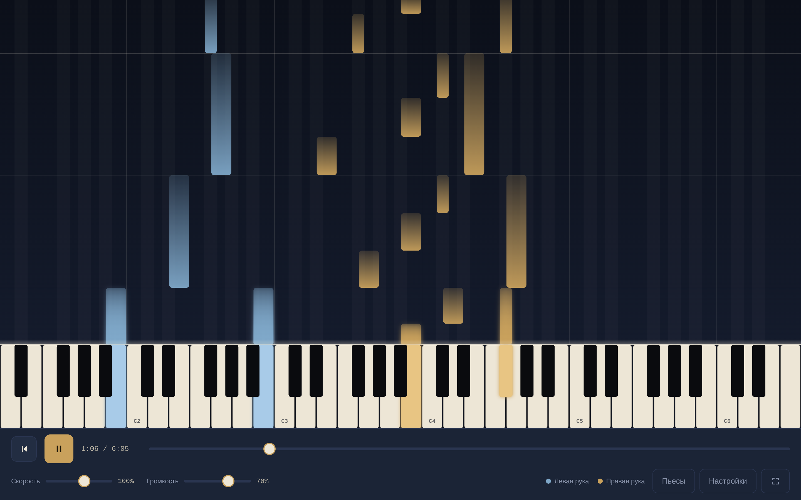

# Падающие ноты

**[English version →](README.md)**

Тренажёр игры на фортепиано по MIDI-файлам. Ноты падают сверху к нарисованной клавиатуре — играйте, когда они долетают до светлой линии. Левая и правая рука разделены цветом, звук синтезируется браузером.

Один HTML-файл без внешних зависимостей, без сборки и без сервера. Работает офлайн.

**Попробовать вживую: [belf186.github.io/falling-notes](https://belf186.github.io/falling-notes/)**

## Возможности

- **Свой парсер MIDI** (формат 0 и 1) — без библиотек, понимает карту темпов и размер такта
- **Разделение рук**: по именам треков (распознаются шесть языков подписей), а если имена ничего не дают — по средней высоте треков; файл с одним треком делится по границе высоты, которую двигаете сами. Любое назначение можно поправить вручную — поправки запоминаются у каждой пьесы отдельно
- **Транспорт**: играть/пауза, перемотка, скорость 25–150 % без изменения высоты звука, громкость
- **Сетка**: линии тактов и долей (размер берётся из самого MIDI), границы октав, столбцы чёрных клавиш — каждое отключается
- **Разбег** перед первой нотой, чтобы пьеса не начиналась в упор от старта
- **Библиотека пьес**: загруженные файлы хранятся на устройстве и переключаются одним касанием
- **Режим «только клавиши»**: панели убираются, нотам отдаётся весь экран
- **Ввод с MIDI-клавиатуры** (Web MIDI): ваша игра звучит и подсвечивает клавиши на экране
- **Интерфейс на русском и английском** — переключается в «Настройках»
- **Ставится как приложение** на iPad («На экран „Домой“») и дальше работает без интернета

## Жесты

| Жест | Что делает |
|---|---|
| Короткий тап по полю нот | Играть / пауза |
| Протянуть пальцем по полю | Перемотка. Вверх — назад по времени, как будто держишь саму ленту с нотами |
| Пробел / Home / ← → | Играть-пауза / в начало / ±5 с |

Панели убираются значком в правом нижнем углу транспорта и возвращаются кружком в углу экрана.

## Игра на MIDI-клавиатуре

Откройте «Настройки», в разделе «MIDI-клавиатура» нажмите «Подключить», разрешите доступ и выберите устройство. Сыгранные ноты звучат во встроенном синтезаторе и подсвечивают клавиши на экране. Педаль сустейна (CC64) поддерживается, устройства можно подключать и отключать на ходу.

Web MIDI работает в Chrome и Edge на компьютере и Android. Safari на iPhone и iPad его не поддерживает. На Android по Bluetooth сначала соедините клавиатуру в бесплатном приложении-мосте, например MIDI BLE Connect, затем нажмите «Подключить». Проверены не все устройства.

Если Web MIDI не показывает клавиатуру, кнопка «Bluetooth напрямую» подключает BLE-MIDI-клавиатуру через Web Bluetooth (Chrome на компьютере и Android). Кнопка видна только в браузерах с поддержкой Web Bluetooth.

Разбор пакетов вынесен в чистую функцию с тестами на Node: `node --test tests/*.test.js`.

## Попробовать

Откройте страницу в любом современном браузере — или поставьте на планшет:

1. Открыть страницу в Safari на iPad
2. Кнопка «Поделиться» → **«На экран „Домой“»**
3. Запускать с иконки: весь экран, без адресной строки, работает без сети

На Android и на компьютере то же самое делается в Chrome: меню ⋮ → «Добавить на главный экран» (на телефоне) или значок установки в адресной строке (на компьютере).

Свою музыку загружайте кнопкой **«Загрузить MIDI»** — подойдёт любой файл `.mid` / `.midi`; на компьютере можно просто перетащить его на страницу.

## Где брать MIDI-файлы

Приложение играет любой стандартный MIDI. Куда стоит заглянуть:

| Источник | Что там |
|---|---|
| [piano-midi.de](http://piano-midi.de) | Классика, руки уже размечены в именах дорожек, CC BY-SA. Сайт открывается **только без** `www` |
| [Mutopia Project](https://www.mutopiaproject.org) | Набрано с нот, свободные лицензии, ноты не слипаются |
| [ThePandaTooth](https://www.pandatooth.com/sheet-music/) | Фортепианные аранжировки музыки из фильмов и игр, сделаны пианистом — часто есть дорожка `Left Hand` |
| [BitMidi](https://bitmidi.com) | Больше ста тысяч файлов, найдётся почти что угодно |

На что смотреть: файл, сделанный для оркестрового воспроизведения — много инструментов на
отдельных дорожках — загрузится и заиграет, но это не фортепианная партия, и выглядит она
стеной нот. В больших архивах выбирайте файлы, где в названии есть «piano».

## Встроенная пьеса

Бетховен — Соната № 14 до-диез минор, соч. 27 № 2 («Лунная»), первая часть.

MIDI-файл: [piano-midi.de](http://piano-midi.de), автор записи — Бернд Крюгер (Bernd Krueger), редакция 2012-06-03.
Лицензия: **Creative Commons Attribution-ShareAlike (CC BY-SA)**. Файл включён в `index.html` в неизменном виде и распространяется на тех же условиях.

## Файлы

| Файл | Назначение |
|---|---|
| `index.html` | Само приложение целиком, включая встроенную пьесу |
| `sw.js` | Офлайн-кэш (service worker) |
| `manifest.webmanifest` | Описание приложения для домашнего экрана |
| `icon-*.png` | Иконки |
| `screenshots/` | Картинки для этой страницы |

## Обновление своей копии

Заменить `index.html` новой версией — этого достаточно: стратегия кэша «сеть вперёд», при живом интернете приложение всегда берёт свежий файл, а старая копия служит только запасной на случай отсутствия сети.

Поднимать `VERSION` в `sw.js` нужно, только если менялись сам `sw.js`, манифест или иконки: они лежат в предзагруженном списке `ASSETS` и обновляются вместе со сменой версии кэша.

GitHub Pages отдаёт статику с `Cache-Control: max-age=600`, поэтому свежая версия иногда доезжает не с первой попытки — достаточно открыть приложение повторно.

## Лицензия

Код приложения — под лицензией MIT. Автор оригинала — [Belf186](https://github.com/Belf186/falling-notes); этот форк добавляет ввод с MIDI-клавиатуры. Встроенная «Лунная соната» остаётся под CC BY-SA (см. выше).
